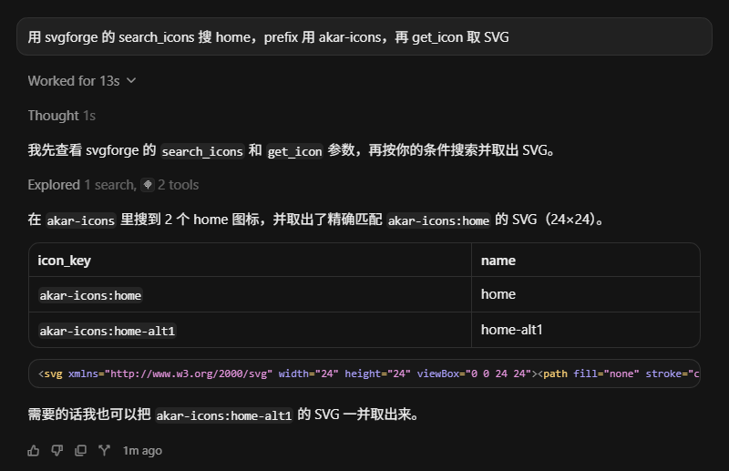

# SVGForge MCP

Lightweight [Model Context Protocol](https://modelcontextprotocol.io/) bridge for [SVGForge](https://svgforge.dev). Search Iconify icons and fetch SVG / React / Vue / Svelte code from Cursor, Claude Desktop, and other MCP clients.

Uses a lightweight **stdio bridge → cloud API** pattern. No local icon database.

- **npm:** [svgforge-mcp](https://www.npmjs.com/package/svgforge-mcp)
- **Docs:** [svgforge.dev/mcp](https://svgforge.dev/mcp)
- **Repo:** [github.com/liqiang88/svgforge-mcp](https://github.com/liqiang88/svgforge-mcp)

## Install / run

```bash
git clone https://github.com/liqiang88/svgforge-mcp.git
cd svgforge-mcp
npm install
npm run build
node dist/index.js
```

Or after publish:

```bash
npx -y svgforge-mcp
```

## Environment

| Variable | Required | Default | Description |
|----------|----------|---------|-------------|
| `SVGForge_API_KEY` | For private tools | — | Personal token `sf_…` from Dashboard → API tokens |
| `SVGForge_API_BASE` | No | `https://svgforge.dev` | API origin (no trailing slash) |
| `SVGForge_MCP_ALLOW_WRITE` | No | off | Set `1` to enable `add_to_collection` |

Public tools work without a key: `search_icons`, `get_icon`, `list_icon_sets`, `sanitize_svg`, `svg_to_data_uri`.

## Cursor

Open **Settings → Customize → MCPs**, then add / edit the server (writes `mcp.json`).

Published package:

```json
{
  "mcpServers": {
    "svgforge": {
      "command": "npx",
      "args": ["-y", "svgforge-mcp"],
      "env": {
        "SVGForge_API_KEY": "sf_xxx",
        "SVGForge_API_BASE": "https://svgforge.dev"
      }
    }
  }
}
```

Local checkout:

```json
{
  "mcpServers": {
    "svgforge": {
      "command": "node",
      "args": ["/www/wwwroot/luo-project/svgforge-mcp/dist/index.js"],
      "env": {
        "SVGForge_API_KEY": "sf_xxx",
        "SVGForge_API_BASE": "https://svgforge.dev"
      }
    }
  }
}
```

Replace the `args` path with your local clone’s `dist/index.js`.

After saving, confirm `svgforge` shows as connected under **Customize → MCPs**. Restart MCP or Cursor if the status stays grey.

Connected and calling `get_icon` in Cursor:



## Claude Desktop

In `claude_desktop_config.json`:

```json
{
  "mcpServers": {
    "svgforge": {
      "command": "npx",
      "args": ["-y", "svgforge-mcp"],
      "env": {
        "SVGForge_API_KEY": "sf_xxx"
      }
    }
  }
}
```

## Tools

| Tool | Auth | Description |
|------|------|-------------|
| `search_icons` | — | Search by keyword / prefix |
| `get_icon` | — | SVG or `react` / `vue` / `svelte` / `data-uri` |
| `list_icon_sets` | — | Browse icon packs |
| `get_my_collections` | Token | User collections |
| `get_custom_icons` | Token + Pro | Private uploads |
| `sanitize_svg` | — | Strip XSS-ish payloads |
| `svg_to_data_uri` | — | CSS / img Data URI |
| `add_to_collection` | Token + `ALLOW_WRITE=1` | Add icon to a collection |

Requests send `X-SVGForge-Client: mcp` for traffic attribution.

## Token

1. Sign in at [svgforge.dev](https://svgforge.dev)
2. Open Dashboard → **API tokens**
3. Create a token (`sf_…`) — same token works for the VS Code extension

## Privacy

The bridge only calls the SVGForge HTTPS API. It does not scan your disk or upload project files.

## License

[MIT](./LICENSE)
